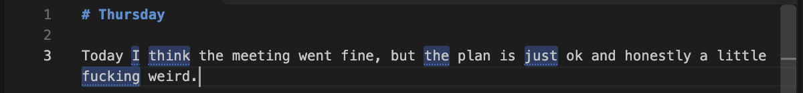
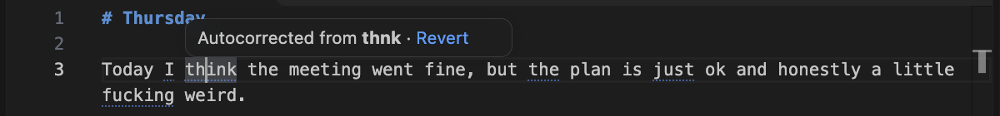
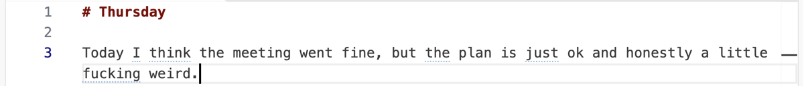

# Local Autocorrect

A free, open-source VS Code extension that fixes typos as you type: smartphone-style autocorrect for desktop text editing. You type fast and sloppy, and the text comes out spelled correctly. You don't press Tab, nothing pops up, and nothing leaves your machine.

It is built for **writing prose**: notes, journals and ideas drafted in Markdown or plain text. It is not for code. Code already has its own tooling, and correcting it is a different problem.

```text
you type:   I thnk taht this woudl be a graet way to imprvoe things.
you get:    I think that this would be a great way to improve things.
```

**Status:** early. Milestone 1 (a deterministic, dictionary-based baseline) works end to end and is tested in a real VS Code instance. There is no language model yet. See [docs/PLAN.md](docs/PLAN.md) for the roadmap.

## Principles

- **Automatic.** Corrections apply when you finish a word, with no confirmation.
- **Conservative.** If a typo is ambiguous it is left alone. A false correction is worse than a missed one.
- **Your vocabulary, swearing included.** `fuckign` becomes `fucking`, never `ducking`. Profanity is ordinary vocabulary here: it is never corrected away, and typos of swear words are fixed like any other typo.
- **Local.** No network calls and no telemetry. Typing history is never stored.
- **Quiet.** No ghost text, suggestion lists or popups. A corrected word gets a soft flash and a faint dotted underline, so you can tell what changed without being interrupted.
- **Reversible.** One undo reverts a correction — and teaches it: the word you typed goes into your dictionary and is never corrected again.

## Try it

Requires Node.js 22.18 or later (the repo runs TypeScript directly through Node's type stripping).

```bash
npm install
```

**Debug:** open this folder in VS Code and press <kbd>F5</kbd> (the "Run Extension" launch config). A new window opens with the extension loaded. Open a Markdown or plain-text file and type `teh `.

**Install locally:**

```bash
npm run package -w local-autocorrect
```

```bash
code --install-extension apps/vscode/local-autocorrect-0.1.0.vsix
```

## Usage

| Command | What it does |
|---|---|
| `Autocorrect: Toggle Autocorrect` | Turn it on or off (also available by clicking the status-bar item). |
| `Autocorrect: Revert Last Correction` | Restore the original word and stop correcting it this session. |
| `Autocorrect: Add Word to Dictionary` | Never correct a word. Pre-fills the word under the cursor or the last corrected word. |

Plain <kbd>Cmd/Ctrl+Z</kbd> right after a correction undoes just the correction and leaves the space or punctuation you typed. The word is then added to `autocorrect.customDictionary` and never corrected again (turn off `autocorrect.learnFromReverts` to keep it per-session instead).

Corrected words briefly flash and then keep a faint dotted underline. Hover over one to see what you typed, and click **Revert** to restore it, even several sentences later. The underlines are kept in memory only and disappear when you close the document.





| Setting | Default | |
|---|---|---|
| `autocorrect.enabled` | `true` | |
| `autocorrect.mode` | `"conservative"` | `"balanced"` also fixes two-slip typos and closer calls. `"aggressive"` also fixes rare words when one plausible candidate is the clear winner. |
| `autocorrect.languages` | `["markdown", "plaintext"]` | Language IDs to correct in. |
| `autocorrect.customDictionary` | `[]` | Words that are never corrected. |
| `autocorrect.learnFromReverts` | `true` | Reverting a correction adds the typed word to the custom dictionary. |
| `autocorrect.correctionCue` | `"flashAndUnderline"` | How corrected words are marked: `"flashAndUnderline"`, `"underline"`, `"flash"` or `"none"`. |

## How it works

```text
packages/core      the engine: pure TypeScript, no VS Code dependency
apps/vscode        the extension: watches typing and applies edits
benchmarks         offline evaluation of the engine
```

Keeping the engine separate from VS Code means it can later back a system-wide macOS app.

**Trigger.** The extension listens to `onDidChangeTextDocument`. A correction is considered only when a single character is typed at a single cursor and that character completes a word: a space, tab, Enter, `,` `;` `!` `?` `)` `]` `}` or `"`. Typing `.` or `:` never triggers a correction, because those characters also appear inside URLs, paths and `e.g.`. The word is checked when you type the next space instead.

**Safety rules**, in [safety.ts](packages/core/src/safety.ts) and [engine.ts](packages/core/src/engine.ts). A word is left alone if any of these apply:

- It is shorter than 3 letters, contains digits, `_` or `'`, or is ALL CAPS or mIxEd case (`useState`, `iPhone`).
- It is part of a larger token: anything attached on the left other than an opening bracket or quote, or anything but punctuation and then whitespace on the right. That rule covers URLs, paths, emails and `dotted.names`.
- It is capitalised mid-sentence, so it is probably a name.
- It is in your custom dictionary, on a short built-in list of tech words (`repo`, `config`, `async`, …), or was reverted this session.
- In Markdown, it is inside a fenced code block or inline code span.

**Candidates.** A word that survives those checks and isn't in the dictionary goes through two steps:

1. A small hand-written [typo table](packages/core/src/typos.ts) of frequent, unambiguous slips (`teh`, `thnk`), plus contractions typed without the apostrophe (`dont`, `im`, `youre`, `cant`). A contraction is only added when the apostrophe-less form is not a common word, so `its`, `were`, `well`, `ill`, `lets` and `id` are never changed.

A lowercase `i` on its own, or `i'm`, `i've`, `i'll` and `i'd`, is capitalised. `(i)` list markers and `i.e.` are not.
2. A noisy-channel ranking ([spelling.ts](packages/core/src/spelling.ts)). Every dictionary word one typing slip away is scored by *how likely that slip is* × *how common the word is*. Transpositions, doubled letters and adjacent-key hits on a QWERTY layout count as likely slips. A non-adjacent substitution counts as unlikely. The winner must have at least 75% of the total candidate score and clear an absolute minimum, or nothing happens.

**Context.** The word before the typo sharpens the ranking ([bigrams.ts](packages/core/src/bigrams.ts)): a candidate that commonly follows it gets its prior raised in proportion to P(candidate | previous word), from a bundled table of 237k word pairs. Context only ever *adds* evidence — an unseen pair falls back to plain word frequency — so sparse data never vetoes a good fix. This is what lets `as wel` become `as well` (alone, `wel` is too close to `we`) and `a timelin` become `timeline` rather than `timely`. Punctuation between the words breaks the context.

**Lexicon.** About 115k words. Validity comes from [SCOWL](http://wordlist.aspell.net/) (via `wordlist-english`, US + common English, sizes 10–70) and frequency from [SUBTLEX-US](https://www.ugent.be/pp/experimentele-psychologie/en/research/documents/subtlexus) (via `subtlex-word-frequencies`). SCOWL leaves out a lot of informal words and profanity. [lexicon/informal.txt](packages/core/lexicon/informal.txt) adds them back (`clusterfuck`, `shitshow`, `dumbass`, `haha`, …). `npm run build` generates `packages/core/data/en-US.tsv` from all three sources. The word-pair table (`packages/core/data/bigrams-en.tsv`, committed) is pruned from the [Google Web Trillion Word Corpus bigram counts published by Peter Norvig](https://norvig.com/ngrams/) to pairs of lexicon words ([build-bigrams.mjs](packages/core/scripts/build-bigrams.mjs)). The extension loads both once at startup.

**Applying the edit.** The edit is a minimal `TextEditor.edit` replacement of just the word, with undo stops on both sides. The extension host is told about a typed character before it learns the cursor moved, so the controller waits for the selection update. Before editing, it re-checks that the word is unchanged and that there is still exactly one empty cursor at or after the boundary character. If you type quickly and the editor rejects the edit as stale, it re-checks and tries once more. The extension's own edits replace a non-empty range, so they can never look like a typed boundary character and re-trigger correction.

## Tests and benchmarks

```bash
npm test
```

That runs the engine unit tests (`node --test`) and then the integration suite, which downloads VS Code into `apps/vscode/.vscode-test/` and drives a real editor with the `type` command. Set `VSCODE_EXECUTABLE` to use an installed build instead.

```bash
npm run bench
```

Current numbers on an M-series Mac:

| | conservative (default) | balanced | aggressive |
|---|---|---|---|
| Hand-written typos (54): recall / precision | 87.0% / 100% | 96.3% / 100% | 98.1% / 100% |
| Synthetic single-slip typos (2,000): recall / precision | 87.6% / 96.6% | 90.0% / 94.3% | 90.0% / 94.2% |
| Context-dependent typos (15): recall with / without bigrams | 86.7% / 40.0% | 86.7% / 60.0% | 100% / 86.7% |
| False corrections per 1,000 words of clean text | 0 (411 words) | 0 (411 words) | 0 (411 words) |
| Median / p95 engine time per word | 0.07 / 0.14 ms | 0.08 / 105 ms | 0.08 / 0.22 ms |

These are small, partly synthetic datasets. The synthetic typos use the same slip types the engine models, so they flatter recall. Treat the numbers as a regression check, not a quality claim. A larger and more honest evaluation set is Milestone 4.

### Verified vs. assumed

Verified by the integration suite in VS Code 1.144 on macOS:

- The acceptance cases (`teh`, `recieve`, `thnk`, `I woudl go` are fixed; `Ethereum`, `useState` and `https://example.com` are untouched) are corrected or left alone as expected.
- `fuckign` is corrected to `fucking`, and a correctly typed `fucking` is left alone.
- `so i think im done` becomes `so I think I'm done`.
- The cursor stays after the corrected word when the word's length changes.
- Corrections keep up with fast typing.
- Corrections work mid-line.
- A single undo reverts only the correction, and the word is not re-corrected afterwards.
- The revert and add-to-dictionary commands work, and so does toggling.
- Disabled languages, fenced and inline Markdown code, multi-cursor typing and programmatic inserts are left alone.

Not verified:

- IME composition.
- Snippet tab-stops.
- Behaviour with other extensions that also edit on type, such as Markdown list continuation and Vim emulation.
- Windows and Linux. CI runs the suite on Ubuntu, but nobody has used it there by hand.

## Known limitations

- **English (US) only**, QWERTY only.
- **Context is one word deep.** The previous word helps rank candidates, but real-word errors (`I don't thing this is going to word`) are still never touched, and a typo that is itself a known-but-rare word (`tha`, `sens`) is skipped. Catching those needs a language model (Milestone 3).
- **IME and snippets can't be detected** through the extension API. IME commits usually insert several characters at once, which never triggers a correction, but this hasn't been tested.
- **Hyphenated words are skipped.** Contractions are only fixed when the apostrophe-less form isn't a real word, so a missing apostrophe in `its`, `were` or `well` won't be fixed.
- **Suppression is per session.** Reverted words become correctable again after a reload. Use *Add Word to Dictionary* to make it permanent.
- **Prose only, by design.** Only Markdown and plain text are enabled by default. Source code, including comments and docstrings, is out of scope.
- Words missing from SCOWL that are close to a common word could still be miscorrected. Please report them.

## Licence

MIT. Bundled word data: SCOWL (permissive, notice shipped as `SCOWL-COPYRIGHT.txt` in the extension), SUBTLEX-US frequencies (Brysbaert & New, 2009) via an ISC-licensed npm package, and bigram counts from the Google Web Trillion Word Corpus as published by Peter Norvig. See [THIRD_PARTY_NOTICES.md](THIRD_PARTY_NOTICES.md).
